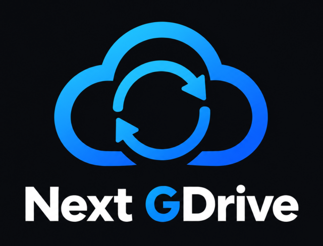

<p align="center">
  
</p>

<p align="center">
  An open-source Google Drive client for Linux, written in Rust.
</p>

<p align="center">
  <a href="https://github.com/diegofaraujo/nextgdrive/actions/workflows/ci.yml"></a>
  <a href="LICENSE"></a>
</p>

> **Status:** early development, not yet ready for important data. Test it on a non-critical account first.

## Features

- **My Drive and Shared Drives**, for **multiple Google accounts**: each account lives in its own folder (`~/GoogleDrive/<email>/My Drive`, `…/Shared drives/<name>`).
- **Two modes per account:**
  - **Mirror**: the folders you choose are copied to the computer and kept in sync in both directions.
  - **Stream**: the whole Drive appears in the account folder, and files are downloaded only when opened. Files and folders can be made **available offline**, and the space used by downloaded content is limited and can be cleared.
- **Safe by default:** nothing is ever deleted permanently in Drive; deleting a file (also from the file manager's trash) sends it to the Google Drive trash. When a file changes on both sides, both versions are kept. Deleting many files at once asks for confirmation.
- **Drive trash**: see and restore trashed items.
- **Google Docs, Sheets and Slides** appear as shortcuts that open in the browser.
- **Tray app** that syncs in the background, with desktop notifications and optional start at login.
- **Command-line interface** with the same features, for headless setups and scripting.
- **Multilingual**: English, Portuguese (Brazil), and Spanish.

## Building from source

Requirements: Rust 1.92 or newer, and the GTK 4 (≥ 4.14) and libadwaita (≥ 1.5) development packages. On Ubuntu or Pop!_OS 24.04:

```bash
sudo apt install libgtk-4-dev libadwaita-1-dev
cargo build --release
```

Stream mode also needs `fusermount3` at runtime (package `fuse3`, installed by default on most desktops).

This produces two programs in `target/release/`: `nextgdrive-gui` (graphical app) and `nextgdrive` (command line).

### Google OAuth client

Next GDrive does not ship Google API credentials yet, so you need your own OAuth client:

1. In [Google Cloud Console](https://console.cloud.google.com/), create a project and enable the **Google Drive API**.
2. Under **Google Auth Platform**, configure the consent screen with audience **External**, and add your Google accounts as **test users**.
3. Under **Clients**, create a client of type **Desktop app** and download its JSON file.
4. Save that file as `~/.config/nextgdrive/oauth-client.json` (or set `NEXTGDRIVE_CLIENT_ID` and `NEXTGDRIVE_CLIENT_SECRET`).

### Usage

```bash
nextgdrive account add       # sign in with Google in your browser
nextgdrive account status    # storage usage of each linked account
nextgdrive account list
nextgdrive account remove <email>
```

```bash
nextgdrive sync folders <email>          # browse drives and folders
nextgdrive sync select <email> <id>      # sync a folder (and everything in it)
nextgdrive sync run                      # sync now
nextgdrive status                        # what the background sync is doing
nextgdrive daemon                        # background sync without the graphical app
```

```bash
nextgdrive config mode <email> stream    # show the whole Drive, download on open (or: mirror)
nextgdrive offline add <path>            # keep a streamed file or folder on this computer
nextgdrive offline list
nextgdrive cache show                    # space used by streamed files
nextgdrive cache limit 10G               # how much they may use (offline files not counted)
nextgdrive cache clear                   # free it, keeping offline files
```

```bash
nextgdrive trash list <email>            # items in the Google Drive trash
nextgdrive trash restore <email> <id>
```

The graphical app (`nextgdrive-gui`) offers all of this. It lives in the system tray: closing the window keeps syncing, and **Quit** in the tray menu stops it.

Refresh tokens are stored in the system keyring (Secret Service, such as GNOME Keyring), never in plain files.

## Architecture

The project follows Clean Architecture with a Hexagonal (Ports & Adapters) design. The core sync logic does not depend on Google APIs, the filesystem, or the GUI and CLI; those are adapters around it.

## Contributing

Contributions are welcome! See [CONTRIBUTING.md](CONTRIBUTING.md) for the workflow and guidelines. Questions and ideas go to [Discussions](https://github.com/diegofaraujo/nextgdrive/discussions); to report a security problem, see [SECURITY.md](SECURITY.md).

## License

Licensed under the [GNU General Public License v3.0](LICENSE) or (at your option) any later version.
